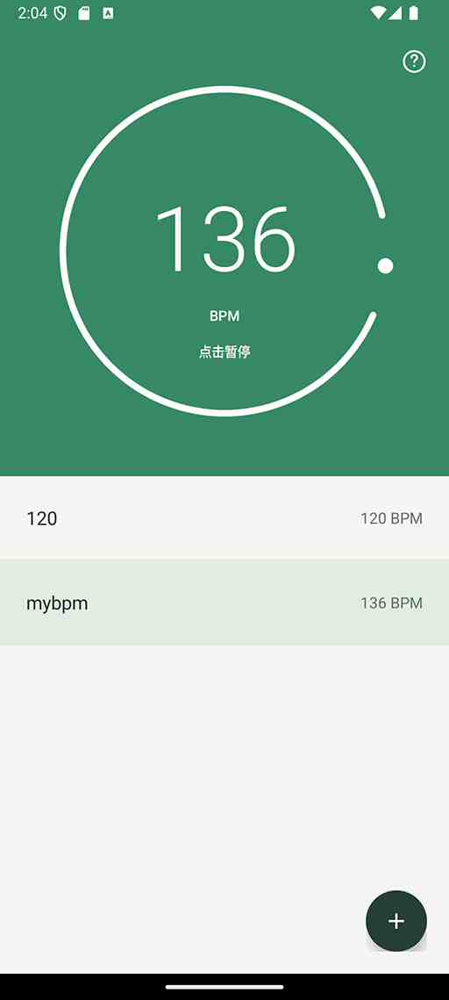

# TikTik

TikTik 是一款简洁的 Android 节拍器，支持旋转调速和保存常用节拍，方便日常练习。

## 功能

- **圆环调速**：顺时针加速、逆时针减速，每次调整 1 BPM，范围为 1–999 BPM；支持惯性旋转。
- **播放与暂停**：点击圆环中央的 BPM 数字切换播放状态，绿色表示播放，橙色表示暂停。
- **节拍预设**：点击右下角的新增按钮，将当前 BPM 保存为命名预设，默认名称为当前 BPM。
- **调整与保存**：点击列表中的预设即可播放；旋转调速后，点击保存按钮才会更新该预设。
- **列表管理**：支持长按修改名称、滑动删除。
- **统一节拍音**：使用合成短音，按音频采样帧安排节拍，不区分强弱拍。

点击右上角的 **?** 可查看操作说明。

## 截图

